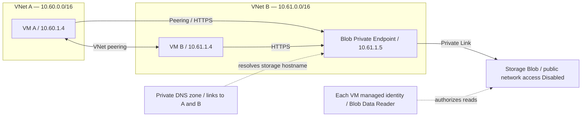

# Lab06 — Azure Advanced Networking

Hilaire's personal AZ-104 learning path. Practice completed October 17–18, 2026 (Edmonton dates). Lab numbering belongs to this personal path, not the official Microsoft lab catalog.

**Status: all four core blocks completed and cleaned up. Portal/CLI tests and Bicep deployments verified.** Blocks 3 and 4 used in-place Bicep adoption of portal-created resources; fresh reconstruction of those complete blocks was not tested.

## Objective

Connect two private Azure networks, explain how routing and security rules affect traffic, compare service endpoints with private endpoints, and diagnose connectivity using Bastion and Network Watcher. Build each block through the portal, inspect and test it through Azure CLI, then declare its infrastructure with Bicep.

## Architecture

The same two-VM baseline was reused across four separately cleaned-up blocks. This diagram shows the Block 3 private storage path; Bastion was practiced separately in Block 4.

Addresses above are observed historical values. VM and Private Endpoint IPs are allocated dynamically; read them back when reproducing. The VMs have no public IPs. Their workload subnets are `10.60.1.0/24` and `10.61.1.0/24`, with implicit default outbound access disabled.

## Verified exercises

| Block | Exercise | Observed result |
|---|---|---|
| 1 | ICMP before peering | A-to-B: 4 sent, 0 received |
| 1 | Bidirectional peering | Both links Connected; A-to-B and B-to-A ping: 4/4 replies, 0% loss |
| 1 | Effective route | Destination 10.61.0.0/16 active through VNetPeering |
| 2 | User-defined discard route | Next hop None blocked A-to-B; removing the route restored 4/4 replies |
| 2 | NSG rule using destination IP | Inbound ICMP deny on B blocked A-to-B; removal restored replies |
| 2 | NSG rule targeting ASG B | B NIC membership plus destination ASG rule blocked traffic; recovery verified |
| 3 | Custom private DNS | Both VM FQDNs resolved through lab06.internal; ping by name passed |
| 3 | Public DNS | Direct authoritative query returned www.lab06.example A 192.0.2.10 |
| 3 | Service endpoint / selected networks | A read Blob with HTTP 200; B received HTTP 403 through the public endpoint |
| 3 | Blob Private Endpoint | Both VMs resolved the usual storage hostname to 10.61.1.5 and read with HTTP 200 |
| 3 | Disable public storage access | Both private reads still returned HTTP 200 |
| 4 | Bastion Developer | Browser SSH login to VM A succeeded without a VM public IP |
| 4 | Network Watcher Next hop | A-to-B: VirtualNetworkPeering / System Route |
| 4 | IP flow verify | SSH packet allowed, denied by a targeted NSG rule, then allowed after rule removal |
| All | Cleanup | Dedicated lab RG absence confirmed after each block: az group exists returned false |

See [EVIDENCE.md](EVIDENCE.md) for the results and interpretation limits.

## Repository contents

| File | Purpose |
|---|---|
| [bicep/main.bicep](bicep/main.bicep) | Two VNets, NSGs, NICs, Linux VMs and optional bidirectional peering |
| [bicep/block2.bicep](bicep/block2.bicep) | Baseline plus route table, ASG membership and ICMP block/recovery parameters |
| [bicep/block3.bicep](bicep/block3.bicep) | Block 2 plus DNS, VM identities, storage firewall, Blob roles and Private Endpoint |
| [bicep/blob-reader-role.bicep](bicep/blob-reader-role.bicep) | Blob Data Reader assignment using current identity or an existing assignment name |
| [bicep/block4.bicep](bicep/block4.bicep) | Baseline module plus Bastion Developer in VNet A |
| [scripts/test-storage-endpoint.sh](scripts/test-storage-endpoint.sh) | DNS and managed-identity Blob read from a VM; never displays the token |
| [data/endpoint-test.txt](data/endpoint-test.txt) | Test payload, seeded separately from infrastructure |
| [REPRODUCTION.md](REPRODUCTION.md) | CMD setup, deployment paths, tests and cleanup |

Templates retain the resource declarations used in the verified deployments. Environment-specific adoption parameters, SSH keys, compiled ARM JSON and raw screenshots are excluded. The test script has one documented adaptation: supply the chosen storage account through `LAB06_STORAGE_ACCOUNT` inside the script, or change its default; its original default matches the observed lab.

## Bicep verification

- **Block 1:** fresh baseline deployment succeeded after correcting the VM security configuration; both peering directions and pings passed.
- **Block 2:** adoption and the UDR/IP/ASG block/recovery deployments succeeded. Final route array was empty, both NSGs had no custom rules, and B remained in its ASG.
- **Block 3:** validation and adoption succeeded with existing RBAC assignment GUIDs and DNS link names. VM identities were preserved. Both private Blob reads, private/public DNS checks and disabled public storage access were verified afterward.
- **Block 4:** validation passed; what-if predicted seven modifications, four unchanged and two ignored resources, with no resource creation or deletion. Adoption succeeded. A new Bastion SSH session, A-to-B ping and CLI IP flow verify passed afterward.

The what-if previews included differences for Azure-generated properties and omitted defaults. These are not presented as zero-difference previews. Incremental deployments update declared resources; a resource omitted from a later template is not automatically deleted. Run blocks independently rather than applying an earlier baseline over a later block's topology.

## Troubleshooting and lessons learned

| Observation | Explanation or correction |
|---|---|
| Explicit VM securityType Standard failed despite validation | This subscription required the UseStandardSecurityType feature. Omitting securityProfile under Compute API 2024-11-01 allowed deployment; no subscription feature was enabled. |
| Portal-created SSH allow rule appeared unexpectedly | Inspected NSG rules and removed the unneeded rule; private ICMP still passed. |
| Deny rule on A did not block inbound traffic to B | Applied the inbound rule to B's NSG. Direction is relative to the resource being examined. |
| Peering route appeared Invalid after adding a discard route | The user route with matching prefix was selected; the peering itself was not deleted. |
| B returned Blob HTTP 403 | In the controlled endpoint comparison, identities and permissions were already working; the network restriction explained the change. A 403 in general does not uniquely identify a firewall issue. |
| Private DNS zone name did not open in a browser | A DNS zone is not a web application URL. Applications continue using the normal storage account hostname. |
| Bastion connection popup was blocked | Allowed the portal popup or opened the connection without a new-tab request. |

A **service endpoint** is enabled on a subnet and permits that subnet to be identified by supported service network rules. Traffic uses the service's public endpoint over the Microsoft network. It creates neither a new storage URL nor a NIC/private IP in the subnet.

A **private endpoint** creates a separate NIC with an address in the selected existing subnet. It does not add a second NIC to the VM or automatically create a new subnet. Private DNS steers the usual storage hostname to that address. A DNS VNet link provides name resolution; network reachability still requires a route, such as peering.

Managed identity authentication, RBAC authorization and network access are separate requirements. A Private Endpoint does not itself grant permission to read blobs.

## Scope and limitations

The public DNS exercise queried Azure's authoritative name server directly. The reserved `.example` name was not delegated on the Internet and did not host a website. `192.0.2.10` was an example record value.

Bastion Developer connected to A in its own VNet. The guest's ping to B does not establish Developer support for direct Bastion connections to peered-VNet VMs. IP flow verify evaluates Azure security rules; it does not establish a live SSH session or inspect the guest firewall.

The storage template creates a container, not the blob payload. Fresh Block 3 provisioning and data seeding are a documented reproduction path, not an observed successful fresh rebuild. Do not reuse deleted VM principals or stale assignment GUIDs. Images use `latest`, so later deployments may select a different image version.

NAT Gateway, VPN Gateway, Azure Firewall, packet capture and Connection Monitor were not deployed. These labs do not demonstrate general Internet egress, throughput or exhaustive AZ-104 coverage.

## Evidence and cleanup

Original screenshots and CLI transcripts remain in the private local archive. This repository provides an English verification summary without personal account identifiers, private keys or access tokens. Each dedicated lab RG was deleted after its tests. The final October 18 group existence check returned `false`; regional/shared Network Watcher resources were outside that deletion scope. This is not a subscription-wide cost audit.

## Microsoft references

- [VNet peering](https://learn.microsoft.com/en-us/azure/virtual-network/virtual-network-peering-overview)
- [Azure routing](https://learn.microsoft.com/en-us/azure/virtual-network/virtual-networks-udr-overview)
- [Application security groups](https://learn.microsoft.com/en-us/azure/virtual-network/application-security-groups)
- [Storage network security](https://learn.microsoft.com/en-us/azure/storage/common/storage-network-security)
- [Storage private endpoints](https://learn.microsoft.com/en-us/azure/storage/common/storage-private-endpoints)
- [Private DNS VNet links](https://learn.microsoft.com/en-us/azure/dns/private-dns-virtual-network-links)
- [Bastion Developer](https://learn.microsoft.com/en-us/azure/bastion/quickstart-developer)
- [Network Watcher CLI](https://learn.microsoft.com/en-us/cli/azure/network/watcher)
